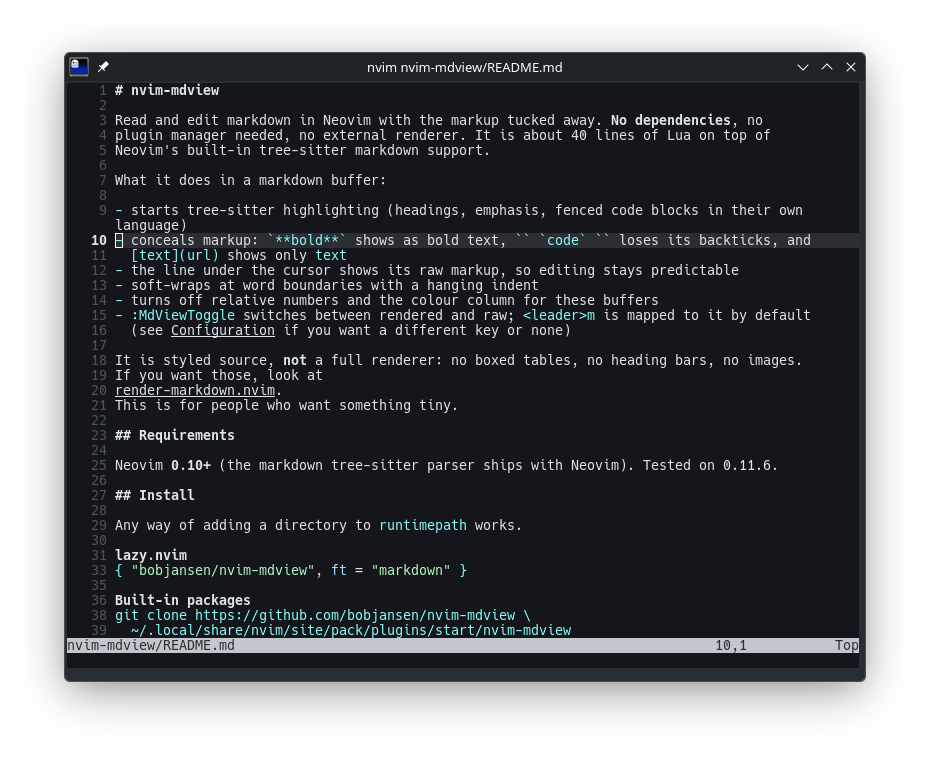

# nvim-mdview

Read and edit markdown in Neovim with the markup tucked away. **No dependencies**, no
plugin manager needed, no external renderer. It is about 40 lines of Lua on top of
Neovim's built-in tree-sitter markdown support.



What it does in a markdown buffer:

- starts tree-sitter highlighting (headings, emphasis, fenced code blocks in their own language)
- conceals markup: `**bold**` shows as bold text, `` `code` `` loses its backticks, and
  `[text](url)` shows only `text`
- the line under the cursor shows its raw markup, so editing stays predictable
- soft-wraps at word boundaries with a hanging indent
- turns off relative numbers and the colour column for these buffers
- `:MdViewToggle` switches between rendered and raw; `<leader>m` is mapped to it by default
  (see [Configuration](#configuration) if you want a different key or none)

It is styled source, **not** a full renderer: no boxed tables, no heading bars, no images.
If you want those, look at
[render-markdown.nvim](https://github.com/MeanderingProgrammer/render-markdown.nvim).
This is for people who want something tiny.

## Requirements

Neovim **0.10+** (the markdown tree-sitter parser ships with Neovim). Tested on 0.11.6.

## Install

Any way of adding a directory to `runtimepath` works.

**lazy.nvim**
```lua
{ "bobjansen/nvim-mdview", ft = "markdown" }
```

**Built-in packages**
```sh
git clone https://github.com/bobjansen/nvim-mdview \
  ~/.local/share/nvim/site/pack/plugins/start/nvim-mdview
```

## Configuration

Set `vim.g.mdview` **before** the plugin loads (anywhere in your `init.lua`):

```lua
vim.g.mdview = {
  enable = true,        -- false disables everything
  conceallevel = 2,     -- 2 hides markup, 0 shows raw
  concealcursor = "",   -- "n" keeps the cursor line concealed in normal mode too
  wrap = true,          -- soft-wrap, linebreak and breakindent
  indent = 2,           -- shiftwidth and tabstop for markdown
  map = "<leader>m",    -- buffer-local toggle key; false for none
}
```

`<leader>` is whatever you set `vim.g.mapleader` to (Neovim's default is `\`). Set it before
opening a markdown file so the mapping picks it up. To use another key, set `map = "<localleader>m"`,
`map = "gm"` or similar, or `map = false` and map `:MdViewToggle` yourself.

The `:MdViewToggle` command comes from `plugin/mdview.lua`, so copying `ftplugin/markdown.lua`
alone gives you the settings but not the command.

Everything is optional. Settings are window-local and are reset by Neovim's
`b:undo_ftplugin` when the filetype changes.

## Tips

- Open a file read-only with `nvim -R README.md` (or `view README.md`) for a pure viewer.
- Concealment depends on your colourscheme not hiding the conceal groups; the stock
  schemes and most popular ones work fine.

## License

MIT
